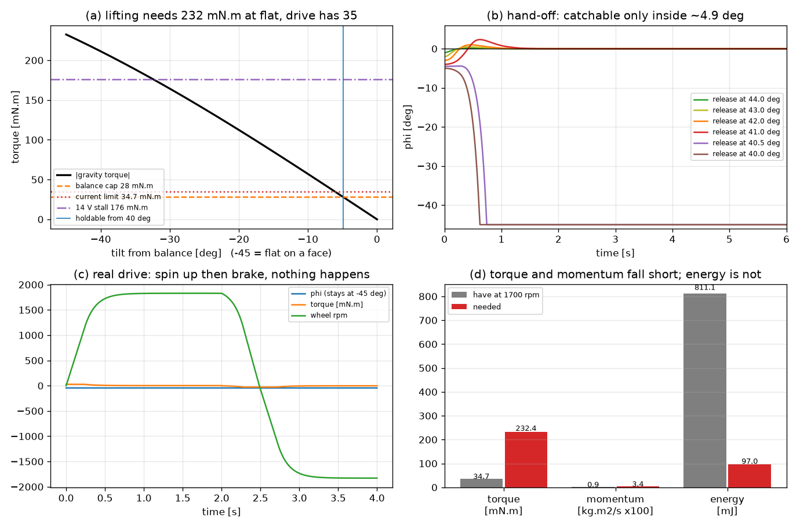

# 47 分析：目前能不能实现"自动起立并平衡"

> 结论先行：**不能**。不是调参问题，也不是固件问题——是硬件能力差 6.7~8.3 倍。
> 现在的固件能做到的是"**手扶到 41° 以上松手，它自己接住并稳住**"（仿真与实测都成立）。
> 要让 Cube 从平放姿态自己站起来，需要机械助起或换执行器，二选一。

- 日期：2026-11-12
- 版本基线：`v0.10-speed-zero`（`Code=90236`，`FW_BUILD_ID = 2`）
- 仿真脚本：[`sim/s8_standup_feasibility.py`](../sim/s8_standup_feasibility.py)
- 仿真图：[`sim/figs/s8_standup_feasibility.png`](../sim/figs/s8_standup_feasibility.png)
- 相关：`docs/02` §G-4（轻推 2 s 恢复）、`docs/18#T20`（工作点与零点）、`docs/45` §4.5（捕获窗）、`docs/43` §5.4（J 与摩擦实测）

---

## 1 "自动起立"的定义

一句话：立方体**平放在桌面上**（一个面贴桌），不发任何外部指令，自己转到**棱上**并稳住。

这个过程中立方体要绕底边转 45°，质心从 `a/2 = 52 mm` 抬到 `a/√2 = 73.5 mm`，
潜在能量差：

```
ΔE = m·g·(a/√2 − a/2) = 0.459 × 9.81 × (0.0735 − 0.052) = 97.0 mJ
```

反作用轮只能通过**电机力矩**把能量交给机体——这一点决定了下面三个预算的算法。

## 2 模型与参数

绕底边转动 + 同轴反作用轮（与 `docs/44` §4.1 同一植物模型）：

```
I_tot·φ̈ = m·g·h·sin φ − τ + τ_f
J_w·(φ̈ + ω̇) = τ − τ_f
```

| 参数 | 值 | 来源 |
|---|---|---|
| 立方体边长 `a` | 104 mm | 用户实测 |
| 质量 `m` | 0.301 + 0.158 = 0.459 kg | 用户实测（含电池） |
| 平衡时质心高 `h` | 73 mm | 用户实测（≈ a/√2） |
| 轮惯量 `J_w` | 5.12e-5 kg·m² | S3 台架实测（`docs/43` §5.4） |
| 绕底边惯量 `I_edge` | 5.79e-3（空心壳）/ 3.31e-3（实心） | 由边长质量推算，取大者（保守） |
| `mgh` | 0.3287 N·m | 计算 |
| `Kt` | 0.02891 N·m/A | `motor_cfg.h` |
| 相电阻 `R` | 2.3 Ω | `motor_cfg.h` |
| 母线 / 调制后可用 | 14 V（4S）/ 5.7 V | 实测 |
| 平衡环力矩上限 | 28 mN·m | `BAL_MAX_MNM` |
| 固件限流 | 1.20 A → 34.7 mN·m | `MOTOR_I_MAX_MA` |

静态起翻力矩（平放时要打破的那道坎）：

```
τ_tip = m·g·(a/2) = 0.459 × 9.81 × 0.052 = 232.4 mN·m
```

## 3 三个预算：力矩、动量、能量

### 3.1 力矩预算 —— 差 6.7 倍，且**电路上就到不了**

| 配置 | 力矩 | 相对 `τ_tip` |
|---|---|---|
| 平衡环上限 `BAL_MAX_MNM` | 28.0 mN·m | **0.12 ×** |
| 固件限流 1.2 A | 34.7 mN·m | **0.15 ×** |
| 电气堵转（5.7 V / 2.3 Ω） | 71.6 mN·m | 0.31 × |
| 电气堵转（14 V / 2.3 Ω） | 176.0 mN·m | 0.76 × |
| **需要的** | **232.4 mN·m = 8.0 A** | 1.00 × |

关键点：`τ = Kt·I`，要 232 mN·m 就得 8.0 A 相电流。而 14 V / 2.3 Ω 的**物理堵转电流只有 6.1 A**
（176 mN·m）——也就是说**即使把固件限流、采样量程、散热全部放开，这台电机在这条母线上也举不起自己**。

### 3.2 动量预算 —— 差 2.7~3.7 倍

就算力矩够、走"先把轮子转快再猛刹"的冲量路线，轮子能交出的角动量也不够：

```
机体到达势垒需要的角速度  ω_body = √(2ΔE/I_edge) = 5.79 rad/s（空心）/ 7.65 rad/s（实心）
需要的角动量              L_need = I_edge·ω_body = 0.0335 / 0.0253 kg·m²/s
轮子在 1700 rpm 能给出     L = J_w·ω = 5.12e-5 × 178 = 0.0091 kg·m²/s
```

| 轮速 | 可交出角动量 | 相对需要（空心壳） | 相对需要（实心） |
|---|---|---|---|
| 1700 rpm（跳闸线） | 0.0091 kg·m²/s | **0.27 ×** | 0.36 × |
| 2000 rpm | 0.0107 | 0.32 × | 0.42 × |
| 2300 rpm（4S 空载极限附近） | 0.0123 | 0.37 × | 0.49 × |

### 3.3 能量预算 —— 够，但取不出来

轮子在 1700 rpm 存了 `½J_wω² = 811 mJ`，是 97 mJ 的 8.4 倍。
**能量不是瓶颈**，但把轮子的动能变成立方体的转动只能经过电机力矩——而力矩比 `τ_tip` 小 6.7 倍，
所以这 811 mJ 拿不出来。这也解释了为什么"多转几圈轮子"没用。

## 4 仿真验证

脚本：`sim/s8_standup_feasibility.py`（numpy + matplotlib，跑在 `.tmp_env\venv`）：

```
.tmp_env\venv\Scripts\python.exe sim/s8_standup_feasibility.py
```

### 4.1 平放尝试（真机驱动，先转轮再猛刹）

| 力矩上限 | 结果 | 峰值倾角 | 轮速峰值 |
|---|---|---|---|
| 28.0 mN·m | **没抬起来** | −45.00°（纹丝不动） | 1829 rpm |
| 34.7 mN·m | **没抬起来** | −45.00°（纹丝不动） | 1829 rpm |

即：轮子从 0 转到 1829 rpm 再刹回 0，机体**一度都没动**——力矩全被桌面反力吃掉了。

### 4.2 松手角度扫描（编译进固件的平衡律，28 mN·m）

| 松手时离"平放"的角度 | 峰值倾角 | 收尾 | 判定 |
|---|---|---|---|
| 40.0° | −5.00° | −45°（躺倒） | **落回** |
| 40.5° | −4.43° | −45° | **落回** |
| 41.0° | +2.33° | 0.00° | 站住 |
| 42.0° | +1.00° | 0.00° | 站住 |
| 43.0° | +0.46° | 0.00° | 站住 |
| 44.0° | +0.15° | 0.00° | 站住 |

阈值 40.1° 与解析解 `asin(28/328.7) = 4.89°`（离平衡点）**完全对上**；
与 S6 实测的捕获窗 4.5° 也一致——**这是同一把尺子量的**。

### 4.3 图



- (a) 重力矩随倾角下降，四条横线是四种力矩能力——平放处（−45°）需要 232，全都够不着；
- (b) 松手角度扫描：40.5° 落回、41° 起站住（蓝线是 40.1° 的可保持边界）；
- (c) 真实驱动"转轮—猛刹"全过程：倾角一条直线贴着 −45°，轮速上到 1829 rpm 又回到 0；
- (d) 三个预算的柱状对比：力矩 34.7 vs 232、动量 0.9 vs 3.4（×100）、能量 811 vs 97。

## 5 结论

1. **"从平放自动起立"在这套硬件上做不到**，差距 6.7~8.3 倍，且不随参数/固件改变：
   力矩要 8.0 A（母线与绕组都不允许），动量要 3.7 倍的轮速或轮惯量。
2. **"半自动"已经具备**：手扶到离平衡点 4.9° 以内（离平放 ≥40.1°）松手，
   固件靠现成的捕获窗接住并稳住，轮速由零点游走收回到 0（`v0.10-speed-zero` 已上板验证）。
3. 之前那版 `v0.9-stand` 的起立语义（engage 时 `att_zero()` + 参考角 0）就是为"手扶松手"这个
   场景设计的，与本节结论一致——它从来不是"自动起立"。

## 6 要真自动，三条路（按性价比排序）

| 方案 | 做法 | 代价 | 能否用现有固件 |
|---|---|---|---|
| **A. 机械助起**（推荐） | 41°~45° 的斜座 / 弹簧顶杆 / 可释放支架：把立方体托到 41° 以上，松手后固件接手 | 几十元、几天 | **可以，一行代码都不用改** |
| B. 换执行器 | 力矩 ≥ 0.24 N·m（≈8 A）：换高 Kt 电机或加行星减速，同时改采样电阻/量程、AO4606 与散热 | 换硬件、重做保护与标定 | 要改（限流、纹波预算、`BAL_MAX_MNM` 重定） |
| C. 换大惯量轮 + 高转速 | `J_w ≥ 1.4e-4`（2.7 倍）且转速提到 2300 rpm，或 `J_w` 不变但把轮速提到 ~6000 rpm（受 KV 与母线限制，需换电机/升压） | 换机械件 + 换电机 | 要改（平衡增益、跳闸阈值、轮速上限全部重算） |

补充：方案 B/C 落地后，"能否自动起立"要重跑本脚本，判据是
`τ_max > 232 mN·m` **且** `J_w·ω_max ≥ 0.026~0.034 kg·m²/s` 两个都满足。

## 7 对阶段计划的影响

- 本文不改任何固件，"自动起立"**不作为 S8 的目标**；S8 的目标仍是抗扰（轻推 2 s 恢复）与长跑。
- 若用户选方案 A，则新增一件机械件 + 一个"从斜座松手"的测试流程，固件无需改动；
- 若选 B/C，另立阶段（S9），先做执行器选型与保护重做，再重跑本仿真。

## 8 待确认（新增到 `docs/18`）

| 编号 | 事项 | 说明 |
|---|---|---|
| T30 | 自动起立走哪条路 | A 机械助起 / B 换执行器 / C 换轮与转速 / 不做 |
| T31 | 立方体惯量实测 | 本分析对 `I_edge` 取了空心壳上界（5.79e-3）；实心是 3.31e-3，动量需求差 30%。可用"平放逐次加配重测摆动周期"标定 |
